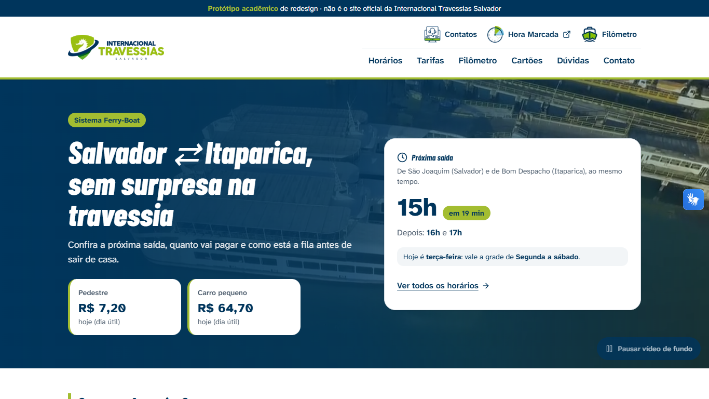

<div align="center">
    <a href="https://kaikbomfim.github.io/FerryBoat-Redesign/" target="_blank">
        
    </a>
</div>

<div align="center">
  
</div>

<h2 align="center">Salvador ⇄ Itaparica sem surpresa na travessia: próxima saída, preço do dia e fila na primeira tela.</h2>

## **Visão Geral**

**FerryBoat Redesign** é um redesign centrado no usuário do site do Sistema Ferry-Boat Salvador–Itaparica ([internacionaltravessias.com.br](https://www.internacionaltravessias.com.br/)), desenvolvido no Desafio Hub de Inovação da disciplina **Otimização de Software para Web**.

O projeto parte de um estudo de caso de usabilidade e acessibilidade do site original e propõe uma nova versão **responsiva**, **acessível** e **rápida**, que mantém a identidade visual da Internacional Travessias (logo, cores, fotos da frota, banners e vídeo institucional). A proposta reorganiza o conteúdo em torno das tarefas que as pessoas mais procuram:

- **Próxima saída** calculada no horário de Salvador, considerando domingos e feriados.
- **Tarifa do dia** já selecionada (dia útil ou fim de semana/feriado) e **calculadora** de preço com prevenção de erros.
- **Filômetro** com a escala oficial de cinco níveis, informada em texto, ícone e cor.
- **Dúvidas** com busca, filtros por assunto e sanfona operável por teclado.
- **Cartões** (Ferry Card, Tarifa Social e Estudante) explicados em linguagem simples.
- **VLibras** em todas as páginas.

Os dados exibidos (tarifas, horários, perguntas frequentes e regras dos cartões) foram coletados do site oficial em 24/11/2026.

> Este é um protótipo acadêmico. Não é o site oficial da Internacional Travessias Salvador.

## **Resultados**

Medições no celular (Google Lighthouse, validador W3C e axe-core), comparando o site original com o redesign:

| Métrica | Site original | Redesign |
|---|---|---|
| Lighthouse – Desempenho | 57 | 97 |
| Lighthouse – Acessibilidade | 79 | 100 |
| Maior conteúdo visível (LCP) | 14,4 s | ≈ 2,5 s |
| Erros no validador W3C (página inicial) | 46 | 0 |
| Violações WCAG 2.2 AA (axe-core) | até 6 tipos por página | 0 |

## Deploy da Aplicação

Confira o FerryBoat Redesign acessando o link a seguir: [FerryBoat Redesign](https://kaikbomfim.github.io/FerryBoat-Redesign/).

## **Instruções de Uso**

Para rodar o **FerryBoat Redesign** localmente, siga os passos abaixo:

1. Clone este repositório:

   ```bash
   git clone https://github.com/kaikbomfim/FerryBoat-Redesign.git
   ```

2. Acesse o diretório do projeto:

   ```bash
   cd ./FerryBoat-Redesign
   ```

3. Instale as dependências do projeto:

   ```bash
   npm install
   ```

4. Inicie o servidor local:

   ```bash
   npm run dev
   ```

5. Acesse a aplicação no navegador em: http://localhost:3000.

## Tecnologias Utilizadas

- **Front-end:** Next.js 16, React 19, TypeScript, Tailwind CSS 4 e shadcn/ui (componentes Base UI).
- **Acessibilidade:** padrões WAI-ARIA, WCAG 2.2 AA e VLibras.
- **Testes:** Google Lighthouse, axe-core, validador W3C e Playwright.
- **Deploy:** GitHub Pages com GitHub Actions (exportação estática).
- **Controle de versão:** Git e GitHub.

## Equipe

- Anderson Mendes dos Santos
- Kaik Ferreira Bomfim

## Possíveis Melhorias

**Melhorias Técnicas**

- Integrar o Filômetro e os boletins diários a uma API em tempo real.
- Gerenciar horários, tarifas e avisos por um CMS.

**Expansões de Funcionalidades**

- Realizar testes A/B e usar mapas de calor para validar a hierarquia da página inicial.
- Integrar a compra da Hora Marcada e a recarga do Ferry Card ao próprio site.
- Adicionar notificações de mudança na fila e nos horários.
